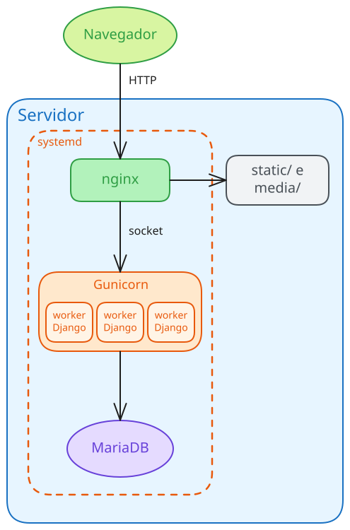

# <!-- fit --> Instalação e Configuração de Servidores

### Prof. Diego Cirilo

**Aula 13**: Deploy de um sistema Django

---
# Deploy

- *Implantar*
- Enviar seu sistema para um servidor de *produção*
- Desenvolvimento/Produção

---

# Desenvolvimento x Produção

| | Desenvolvimento | Produção |
|---|---|---|
| Servidor | `runserver` | *Gunicorn* + *nginx* |
| Banco | *SQLite* | *MariaDB*/*MySQL* |
| `DEBUG` | `True` | `False` |
| Estáticos | Django | *nginx* |
| Configurações | no código | variáveis de ambiente |

- O `runserver` é feito para testes: lento, inseguro e não roda como serviço.

---

# Arquitetura

- O navegador faz requisições HTTP ao servidor;
- O *nginx* entrega os arquivos estáticos e *media*;
- O restante é repassado por um *socket* ao *Gunicorn*, cujos *workers* executam o Django;
- O *systemd* mantém os serviços rodando;
- O Django acessa o banco de dados.

---
# *Gunicorn*

- *Gunicorn* - Unicórnio Verde: servidor WSGI para Python.
- Processa e encaminha as requisições entre o servidor web e a aplicação Python
- Disponibiliza um *socket* para que o *nginx* possa se comunicar com Django.
- Executa vários *workers* (processos) em paralelo.

---
# *systemd*
- Gerencia os serviços (*daemons*) do sistema: *nginx*, *MariaDB*, etc;
- Inicia os serviços no *boot* e é controlado pelo comando `systemctl`;
- O *nginx* e o *MariaDB* já instalam seus serviços;
- Para o *Gunicorn*, criamos os arquivos de *unit* em `/etc/systemd/system/`:
    - `.socket`: cria o *socket* e inicia o *Gunicorn* quando chega uma requisição;
    - `.service`: executa o *Gunicorn*.

---
# *nginx* como *proxy* reverso
- O *nginx* fica na frente da aplicação e recebe todas as requisições;
- Arquivos estáticos e *media* são entregues diretamente, sem passar pelo Django;
- As demais requisições são repassadas (*proxy*) ao *Gunicorn*;
- Também controla o limite de tamanho dos uploads.

---
# Configurações de produção
- `DEBUG = False`: não exibe detalhes dos erros para o usuário;
- `SECRET_KEY`: chave usada na criptografia de sessões, senhas, etc;
    - Nunca adicione o `SECRET_KEY` de prod. ao repositório!!
- `ALLOWED_HOSTS`: IPs e domínios que podem acessar o sistema;
- `DATABASES`: o *SQLite* não é ideal para produção.
- [Documentação](https://docs.djangoproject.com/en/stable/howto/deployment/checklist/)

---
# Variáveis de ambiente
- As configurações de produção ficam em um arquivo `.env` no servidor;
- O `.env` **nunca** vai para o repositório (`.gitignore`);
- O `settings.py` lê as variáveis com `os.environ` e o pacote `python-dotenv`;
- Sem `.env`, valem os valores padrão de desenvolvimento;
- O mesmo código funciona na máquina local e no servidor.

---
# Arquivos estáticos e *media*
- Estáticos: CSS, JS e imagens do sistema;
- *Media*: arquivos enviados pelos usuários (uploads);
- É uma boa ideia manter os arquivos estáticos e *media* separados do código (ex. `/var/www/html/`);
- Dessa maneira não precisamos liberar acesso ao nosso diretório;
- **Risco**: com acesso à pasta do projeto, um erro na configuração do *nginx* pode expor o código-fonte, o `.env` e suas senhas;
- O `collectstatic` copia os estáticos de todas as *apps* para o `STATIC_ROOT`.

---
# *Migrations*
- As *migrations* são criadas no desenvolvimento (`makemigrations`) e enviadas pelo Git;
- No servidor, apenas aplicamos as *migrations* (`migrate`);
- O comando `check --deploy` verifica problemas na configuração de produção.

---
# *Backend* de Email
- Podemos configurar um servidor de emails local;
- Porém hoje em dia qualquer servidor de email *novo* cai em filtros de *spam*;
- Podemos usar um servidor de emails *famoso* através do SMTP;
- *Simple Mail Transfer Protocol*.
- Ex. *Gmail*, com uma senha de app.

---
# Upload de Arquivos
- O *nginx* impõe um limite de 1 MB no tamanho dos uploads;
- Caso o usuário tente um upload maior, acontece o erro 413 (*Request Entity Too Large*);
- É possível aumentar usando a configuração `client_max_body_size`.

---
# Múltiplos projetos
- É possível rodar mais de um projeto em um mesmo servidor;
- Caso haja domínios configurados, é possível mudar o `server_name` no *nginx*;
- Ou usar `subdiretórios`, como `meusite.com/projeto1`, `meusite.com/projeto2`;
- Pode causar problemas caso as *urls* do sistema não estejam perfeitas!

---
# Atualizando o projeto
- Alterações são feitas na máquina local e enviadas pelo Git;
- No servidor:
    - `git pull`;
    - Instalar novas dependências;
    - Aplicar as *migrations* e coletar os estáticos;
    - Reiniciar o *Gunicorn*.

---
# Solucionando erros
- *nginx*: `systemctl status` e o *log* em `/var/log/nginx/error.log`;
- *Gunicorn*/Django: `systemctl status` e `journalctl`;
- Erros comuns:
    - 502 *Bad Gateway*: o *Gunicorn* não está rodando;
    - 400 *Bad Request*: endereço fora do `ALLOWED_HOSTS`;
    - 413: upload maior que o limite do *nginx*.

---
# Passo a passo

- O passo a passo completo do deploy está no tutorial:
- [Deploy de sistema Django no GCloud](https://dvcirilo-ifrn.github.io/ics/tutoriais/tutorial09/)

---
# Referências
- https://docs.djangoproject.com/en/stable/howto/deployment/checklist/
- https://docs.djangoproject.com/en/stable/howto/static-files/deployment/
- https://docs.gunicorn.org/en/latest/deploy.html
- https://realpython.com/django-nginx-gunicorn/

---
# <!--fit--> Dúvidas? 🤔
