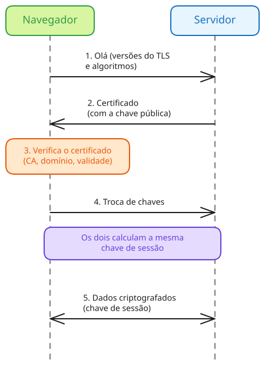
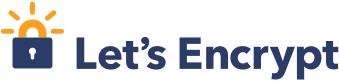
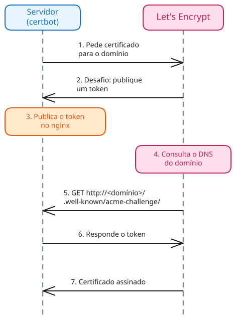

# <!-- fit --> Instalação e Configuração de Servidores

### Prof. Diego Cirilo

**Aula 15**: HTTPS e Certificados Digitais

---
# HTTP x HTTPS

- No *HTTP*, os dados trafegam em texto puro;
- Qualquer um no caminho (Wi-Fi, provedor, etc.) pode ler ou alterar os dados;
    - Senhas, cookies de sessão, formulários...
- *HTTPS*: HTTP sobre uma conexão criptografada (*TLS*);
- Usa a porta 443 (o HTTP usa a 80);
- Navegadores marcam sites sem HTTPS como "Não seguro".

---
# TLS

- *Transport Layer Security*, sucessor do *SSL*;
    - O nome "SSL" ainda é usado no dia a dia (ex. "certificado SSL");
- Garante:
    - **Confidencialidade**: ninguém lê os dados no caminho;
    - **Integridade**: ninguém altera os dados sem ser percebido;
    - **Autenticidade**: o servidor é quem diz ser;
- Versões atuais: TLS 1.2 e TLS 1.3.

---

# Criptografia

| | Simétrica | Assimétrica |
|---|---|---|
| Chaves | uma chave compartilhada | par de chaves: pública e privada |
| Velocidade | rápida | lenta |
| Problema | como compartilhar a chave? | custo computacional |

- O que a chave pública cifra, só a chave privada decifra;
- O TLS usa a assimétrica para autenticar o servidor e combinar uma chave, e a simétrica para os dados.

---
# Certificado digital

- Documento que associa um *domínio* a uma *chave pública*;
- Contém:
    - Domínio (ex. `meusite.com`);
    - Chave pública do servidor;
    - Validade;
    - Emissor e sua assinatura digital;
- A chave privada correspondente fica **apenas** no servidor.

---
# Autoridades certificadoras

- *Certificate Authority* (CA): verifica que você controla o domínio e assina o certificado;
- Navegadores e sistemas operacionais já vêm com a lista de CAs confiáveis (raízes);
- Cadeia de confiança: a CA raiz assina a CA intermediária, que assina o certificado do site;
- Certificado *autoassinado*: não é assinado por uma CA, e o navegador exibe um alerta.

---

# *Handshake* TLS

- Negociação que acontece antes de qualquer dado HTTP;
- O servidor envia o certificado;
- O navegador verifica a assinatura da CA, o domínio e a validade;
- Os dois combinam uma chave de sessão;
- A partir daí, tudo é criptografado com a chave de sessão (simétrica).

---
# Domínios e DNS

- O *DNS* traduz nomes em endereços IP (registro *A*);
- O certificado é emitido para um *domínio*, não para um IP;
- Antes de emitir, a CA verifica que o domínio aponta para o seu servidor;
- Domínios como `.com` e `.com.br` são pagos (ex. [registro.br](https://registro.br)).

---
# DuckDNS

- Alternativa gratuita: subdomínio do [DuckDNS](https://www.duckdns.org) (ex. `meusite.duckdns.org`);
- Basta entrar com uma conta Google ou GitHub e informar o IP do servidor;
- **ATENÇÃO**: no GCP, o IP externo muda quando a VM é desligada e ligada;
- O IP no DuckDNS pode ser atualizado automaticamente pelo próprio servidor.

---
# *Let's Encrypt*

- CA gratuita e sem fins lucrativos;
- Emissão totalmente automatizada, pelo protocolo *ACME*;
- Certificados de curta duração:
    - 90 dias hoje;
    - 64 dias em 2027 e 45 dias em 2028;
- Na prática, a renovação precisa ser automática.

---

# Desafio HTTP-01

- Prova que você controla o domínio;
- O *Let's Encrypt* entrega um *token*;
- O servidor publica o *token* em uma URL do domínio;
- O *Let's Encrypt* acessa a URL pela porta 80;
- Se o *token* estiver lá, o certificado é emitido.

---
# *Certbot*

- Cliente *ACME* mantido pela EFF;
- O *plugin* do *nginx*:
    - Responde ao desafio HTTP-01;
    - Instala o certificado na configuração do site;
    - Redireciona o HTTP para HTTPS;
- A renovação automática é agendada por um *timer* do *systemd*.

---
# HTTPS no *nginx*

- O *nginx* guarda o certificado e a chave privada;
- Ele recebe a conexão HTTPS, descriptografa e repassa a requisição ao *Gunicorn*;
    - Entre o *nginx* e o *Gunicorn*, o tráfego é local (pelo *socket*);
- Requisições HTTP recebem um redirecionamento (301) para o HTTPS;
- A porta 80 continua aberta, para o redirecionamento e a renovação.

---
# HSTS

- *HTTP Strict Transport Security*;
- O servidor avisa o navegador para usar **apenas** HTTPS no domínio, por um tempo;
- Evita que o primeiro acesso por HTTP seja interceptado;
- **Cuidado**: o navegador lembra da regra, então é difícil desfazer;
    - Comece com um tempo curto (ex. 1 hora) e aumente depois.

---
# Django e HTTPS

- Cookies seguros: só são enviados por HTTPS;
    - `SESSION_COOKIE_SECURE` e `CSRF_COOKIE_SECURE`;
- `SECURE_SSL_REDIRECT`: o Django também redireciona para HTTPS;
- `SECURE_HSTS_SECONDS`: ativa o HSTS;
- `SECURE_PROXY_SSL_HEADER`: indica que a requisição chegou ao *nginx* via HTTPS;
- O `check --deploy` aponta as configurações que faltam.

---
# *Firewall*

- A porta 443 precisa estar liberada;
    - No GCP: "Permitir tráfego HTTPS" nas configurações da VM;
- A porta 80 também:
    - Desafio HTTP-01 na emissão e na renovação;
    - Redirecionamento para HTTPS.

---
# Passo a passo

- O passo a passo completo está no tutorial:
- [Configuração de HTTPS com nginx e Let's Encrypt](https://dvcirilo-ifrn.github.io/ics/tutoriais/tutorial11/)

---
# Referências
- https://letsencrypt.org/how-it-works/
- https://letsencrypt.org/docs/challenge-types/
- https://certbot.eff.org/
- https://docs.djangoproject.com/en/stable/topics/security/#ssl-https
- https://developer.mozilla.org/pt-BR/docs/Glossary/HTTPS

---
# <!--fit--> Dúvidas? 🤔
