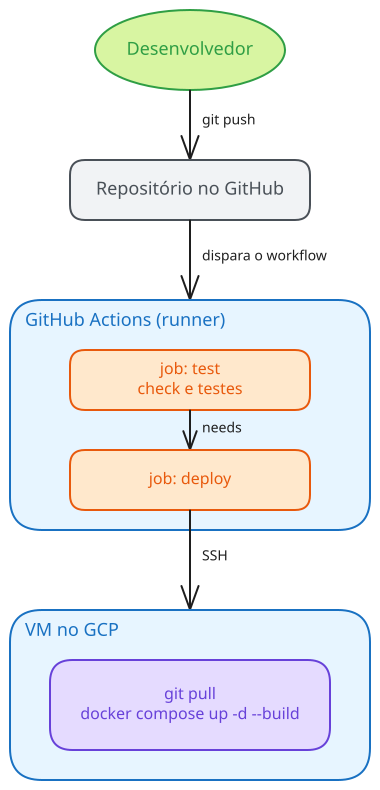

# <!-- fit --> Instalação e Configuração de Servidores

### Prof. Diego Cirilo

**Aula 16**: Implantação Automática (CI/CD)

---
# Implantação manual

- A cada alteração: acessar o servidor, `git pull`, reconstruir, reiniciar...
- Problemas:
    - Passos repetitivos e fáceis de esquecer;
    - Erro humano;
    - Código com erro vai direto para produção;
    - Depende de quem sabe fazer o deploy.

---
# CI/CD

- *Continuous Integration* (Integração Contínua):
    - Cada alteração é verificada e testada automaticamente;
- *Continuous Delivery* (Entrega Contínua):
    - O sistema está sempre pronto para ir para produção;
    - O deploy é feito com um clique;
- *Continuous Deployment* (Implantação Contínua):
    - Cada alteração aprovada nos testes vai para produção automaticamente.

---

# *Pipeline*

- Sequência automatizada de etapas;
- Disparada por um evento (ex. `git push`);
- Etapas comuns: *build*, testes e *deploy*;
- Se uma etapa falha, as seguintes não são executadas;
- O código com erro não chega à produção.

---
# GitHub Actions

- Plataforma de CI/CD integrada ao GitHub;
- *Workflows* descritos em arquivos YAML;
    - Na pasta `.github/workflows/` do repositório;
- Gratuito para repositórios públicos;
- Repositórios privados têm uma cota mensal gratuita.

---
# Conceitos

- *Workflow*: processo automatizado, definido em um arquivo YAML;
- Evento: o que dispara o *workflow*;
- *Job*: conjunto de passos executados em uma mesma máquina;
- *Step*: um comando ou uma *action*;
- *Runner*: máquina que executa o *job*;
- *Action*: passo reutilizável, criado pela comunidade.

---
# Eventos

- `push`: envio de *commits* (ex. para a *branch* `main`);
- `pull_request`: abertura ou atualização de um *pull request*;
- `workflow_dispatch`: execução manual, pela interface do GitHub;
- `schedule`: execução agendada (sintaxe do *cron*).

---
# *Jobs* e *runners*

- Cada *job* roda em uma máquina virtual nova (ex. `ubuntu-latest`);
    - Nada é mantido de uma execução para outra;
- Os *jobs* rodam em paralelo, por padrão;
- `needs` cria uma dependência entre *jobs*:
    - Ex. o *deploy* só roda se os testes passarem.

---
# *Actions*

- Passos prontos, publicados no [GitHub Marketplace](https://github.com/marketplace?type=actions);
- Exemplos:
    - `actions/checkout`: baixa o código do repositório;
    - `actions/setup-python`: instala o Python;
- Sempre indique a versão da *action* (ex. `actions/checkout@v7`);
- Prefira *actions* oficiais ou bem conhecidas: elas rodam com acesso ao seu código.

---
# *Secrets*

- Senhas, chaves e outros dados sensíveis usados nos *workflows*;
- Cadastrados nas configurações do repositório;
- Aparecem mascarados (`***`) nos *logs*;
- **Nunca** coloque senhas e chaves no código ou no YAML.

---
# Estratégias de *deploy*

- **Via SSH**: o *workflow* acessa o servidor, atualiza o código e reconstrói os *containers*;
    - Simples, a imagem é construída no próprio servidor;
- **Via *registry***: a imagem é construída no *runner* e enviada a um *registry* (ex. GHCR);
    - O servidor apenas baixa a imagem pronta;
    - Mais rápido e cada versão fica guardada.

---
# *Deploy* via SSH

- Uma chave SSH exclusiva para o *deploy*;
    - Chave privada: *secret* no GitHub;
    - Chave pública: autorizada no servidor;
- A chave pública do servidor também é cadastrada, para evitar conexões a um servidor falso;
- O usuário precisa estar no grupo `docker`.

---
# Testes no *pipeline*

- O `manage.py check` verifica a configuração do projeto;
- O `manage.py test` executa os testes automatizados;
- No *runner* não existe o `.env` de produção:
    - O projeto roda com as configurações padrão, com *SQLite*;
- Se os testes falham, o *deploy* não acontece.

---
# Boas práticas

- Chaves exclusivas para o *deploy*, com o mínimo de permissões;
- Proteja a *branch* `main`: alterações por *pull request*;
- *Environments* do GitHub permitem exigir aprovação antes do *deploy*;
- Para desfazer um *deploy*: `git revert` e um novo *push*;
- Não altere o código diretamente no servidor.

---
# Passo a passo

- O passo a passo completo está no tutorial:
- [Deploy automático com GitHub Actions](https://dvcirilo-ifrn.github.io/ics/tutoriais/tutorial12/)

---
# Referências
- https://docs.github.com/pt/actions
- https://docs.github.com/pt/actions/security-for-github-actions/security-guides/using-secrets-in-github-actions
- https://github.com/actions/checkout
- https://github.com/actions/setup-python

---
# <!--fit--> Dúvidas? 🤔
